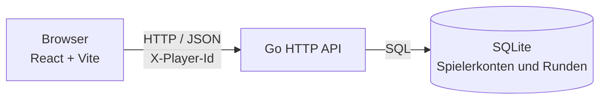

# Chicken Road

Ein Fullstack-Projekt für das Modul M450.

## 🏗️ Architektur
* **Frontend:** React mit Vite für Einsatz, Kontostand und Spielfeld.
* **Backend:** Go mit HTTP- und JSON-API für Spielregeln und Guthaben.
* **Datenbank:** SQLite-Datei für Spielerkonten und Spielrunden.
* **CI:** GitHub Actions testet und baut Backend und Frontend.

Das Backend wurde von Java/Spring Boot zu Go migriert. React bleibt das Frontend und kommuniziert über HTTP mit dem Go-Server. Die Benutzeroberfläche muss deshalb nicht in Go neu geschrieben werden.

### Architektur



### Grobe Planung

1. Den Umfang auf ein virtuelles Spiel mit Kontostand, Einsätzen und zehn Spielfeldern begrenzen.
2. Spielregeln, Validierung und Speicherung im Go-Backend mit einer HTTP/JSON-API umsetzen.
3. Das React-Frontend an die API anbinden und Spielstand sowie Aktionen anzeigen.
4. Regeln, API-Abläufe und Persistenz testen; Tests, Coverage und Builds in GitHub Actions automatisieren.

## 🧑‍💻 Warum Go?
Go eignet sich gut für dieses kleine Backend: Der HTTP-Server ist Teil der Standardbibliothek, das Backend wird als eigenständiges Programm gebaut und die API bleibt übersichtlich. Go ersetzt hier Java nur im Backend; React ist weiterhin eine passende Wahl für die Browseroberfläche. Die Sprache allein garantiert allerdings keine Sicherheit – dafür sind auch korrekte Datenbanktransaktionen, Tests und später eine richtige Benutzeranmeldung nötig.

## 🎮 Spielregeln der Demo
* Eine Runde hat 10 Felder. Das Überfahr-Risiko des nächsten Feldes steigt von 10 % bis 55 % in 5-Prozentpunktschritten.
* Nach jedem sicheren Schritt kann weitergespielt oder ausgezahlt werden.
* Der Gewinn (zusätzlich zum Einsatz) beginnt bei 10 % des Einsatzes und verdoppelt sich pro sicherem Feld: `Einsatz × 0.10 × 2^(sichere Felder − 1)`.
* Ein Treffer verliert den Einsatz. Das Erreichen des zehnten Feldes zahlt automatisch aus.
* Guthaben und Runden sind nur virtuell. Es gibt keine echten Einzahlungen oder Auszahlungen.
* Jedes Browserprofil erhält eine eigene Spieler-ID und CHF 100 Startguthaben. Guthaben und aktive Runden bleiben in `data/chicken-road.sqlite` auch nach einem Backend-Neustart gespeichert.
* Die Spieler-ID liegt im Browser-`localStorage`; Browserdaten löschen oder ein anderer Browser bedeutet deshalb ein anderes Konto. Das ist keine Anmeldung und kein Schutz vor Manipulation.
* Die Go-Version verwendet eine neue SQLite-Datei. Eine eventuell vorhandene H2-Datei aus dem Java-Prototyp wird nicht automatisch importiert.

Diese Regeln sind eine eigene Demo-Variante, keine exakte Kopie der verlinkten 25-Felder-Varianten. Als Recherche zur allgemeinen Chicken-Road-Mechanik (Feld für Feld, steigender Multiplikator und Cash-out) diente die [Chicken-Road-Anleitung](https://chickenroad.ch/de-ch/anleitung/).

## 🚀 Lokal starten
Voraussetzungen: Go 1.23 oder neuer und Node.js 20 oder neuer.

Go-Backend in einem Terminal starten:
```bash
cd backend
go run .
```

React-Frontend in einem zweiten Terminal starten:
```bash
npm ci
npm run dev --workspace frontend
```

Das Frontend ist unter `http://localhost:5173` erreichbar. Das Backend lauscht standardmässig auf `http://localhost:8080`.

## 🧪 Tests und Build
Im Projektstamm:
```bash
cd backend
go test -coverprofile coverage.out ./...
go tool cover -func coverage.out
go vet ./...
go build ./...
cd ..
npm ci
npm run build
```

Die Backendtests prüfen die HTTP-Endpunkte zusammen mit einer temporären SQLite-Datenbank; dadurch werden unter anderem Start, Spielzüge, Auszahlung und Persistenz geprüft. Das Mocking-Framework `testify/mock` steuert in Tests den Zufall, damit Treffer und sichere Schritte reproduzierbar sind. Zusätzlich gibt es Unit-Tests für Einsatzvalidierung, Risikostufen und Auszahlungen.

Bei Pull Requests und Pushes auf `main` führt GitHub Actions die Tests mit Race Detector und Coverage aus. Der Race Detector benötigt lokal CGO und einen C-Compiler; die Coverage-Befehle oben funktionieren auch ohne diese Voraussetzung. Die Coverage-Zusammenfassung erscheint in der Workflow-Zusammenfassung.

### Testberichte in GitHub Actions finden

1. Im GitHub-Repository den Reiter **Actions** öffnen.
2. Links **Chicken Road CI Pipeline** auswählen und in der Liste den gewünschten Workflow-Lauf anklicken (zum Beispiel den neuesten grünen Lauf auf `main`).
3. Auf der Detailseite des Laufs nach unten zum Abschnitt **Artifacts** scrollen.
4. **backend-test-reports** anklicken, um das ZIP mit den Backend-Berichten herunterzuladen.

Das ZIP enthält:
* `test-results.jsonl` – maschinenlesbare Testergebnisse im JSON-Lines-Format.
* `coverage.txt` – Coverage-Zusammenfassung pro Funktion und Gesamt-Coverage.
* `coverage.out` – Coverage-Datei für Go-Werkzeuge, zum Beispiel `go tool cover`.

Die Zusammenfassung der Coverage ist zusätzlich direkt auf der Workflow-Detailseite im Abschnitt **Backend test coverage** zu sehen. Wenn **Artifacts** bei einem älteren Lauf fehlt, wurde dieser Lauf möglicherweise ausgeführt, bevor der Artifact-Upload in der CI-Pipeline eingerichtet war. In diesem Fall einen neuen Lauf nach einem Push oder über **Actions → Chicken Road CI Pipeline → Run workflow** starten.

## 🔌 API-Ablauf
Das Frontend schickt die Browser-Spieler-ID im Header `X-Player-Id`. Die API bietet:
* `GET /api/game/account` – Konto und gegebenenfalls laufende Runde laden.
* `POST /api/game/start` – Runde mit JSON wie `{"betAmount":10}` starten.
* `POST /api/game/{gameId}/step` – den nächsten Schritt ausführen.
* `POST /api/game/{gameId}/cashout` – die aktuelle Auszahlung sichern.

Die H2-Datenbankdatei aus dem alten Java-Backend wird von Go nicht gelesen. Das aktuelle virtuelle Konto liegt in `data/chicken-road.sqlite`.

## 🤖 KI-Nutzung im Projekt
Wir haben KI-Werkzeuge (LLMs) als Nachschlagewerk sowie zur Unterstützung beim Entwickeln, Reviewen und Testen verwendet. KI-generierte Vorschläge müssen von uns geprüft und verstanden werden; wir können den Code erklären, anpassen und manuell erweitern.

## 🧪 Testkonzept & Strategie
* **Unit-Tests:** Prüfen Einsatzvalidierung, Risikostufen und Auszahlungsberechnung.
* **API-/Integrationstests:** Rufen die HTTP-Handler auf und prüfen Spielzüge, Risiko, Auszahlungen, Guthaben, ungültige Einsätze sowie Datenbankpersistenz über einen Backend-Neustart.
* **Mocking:** `testify/mock` steuert in Tests den Zufallsgenerator; dadurch sind Treffer und sichere Schritte reproduzierbar.
* **Automatisierung:** Bei Pull Requests und Pushes auf `main` testet und baut GitHub Actions das Go-Backend und React-Frontend und veröffentlicht Testergebnisse sowie Coverage.

## 🔄 TDD & Code Review Reflexion
Die Tests machen Spielregeln, Guthabenänderungen und Validierung nachvollziehbar. Insbesondere prüfen sie, dass Treffer den Einsatz verlieren lassen, Auszahlungen korrekt gutgeschrieben werden und eine Runde nicht mehrfach gestartet werden kann. Für die persönliche Reflexion ergänzen wir nach dem Projekt ein konkretes Beispiel, bei dem TDD oder ein Code Review zu einer Änderung geführt hat.
